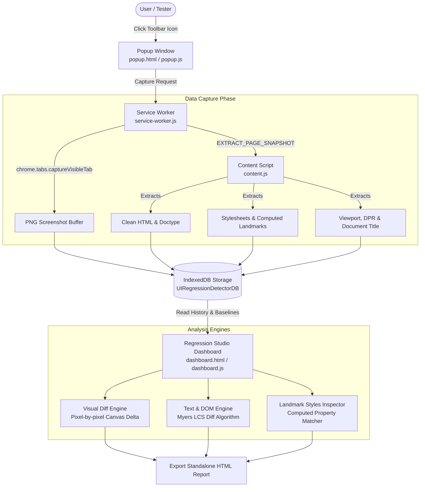

# 🎯 UI Regression Detector

[](https://developer.chrome.com/docs/extensions/mv3/)
[](https://developer.mozilla.org/en-US/docs/Web/JavaScript)
[](https://developer.mozilla.org/en-US/docs/Web/API/IndexedDB_API)
[](https://opensource.org/licenses/MIT)

**UI Regression Detector** is a Google Chrome extension engineered for frontend developers, QA engineers, and designers. It captures full-fidelity page snapshots—combining **high-resolution visual screenshots, full DOM structures, embedded & external CSS, and computed landmark styles**—and provides an analysis studio to detect and inspect regressions between revisions.

---

## 📑 Table of Contents

- [Why UI Regression Detector?](#-why-ui-regression-detector)
- [System Architecture](#-system-architecture)
- [Core Features](#-core-features)
  - [1. Comprehensive Multi-Layer Snapshotting](#1-comprehensive-multi-layer-snapshotting)
  - [2. Quick-Compare Popup](#2-quick-compare-popup)
  - [3. Regression Studio Dashboard](#3-regression-studio-dashboard)
  - [4. Visual Diff Modes](#4-visual-diff-modes)
  - [5. DOM & Code Diff Engine](#5-dom--code-diff-engine)
  - [6. CSS Landmark Styles Inspector](#6-css-landmark-styles-inspector)
  - [7. Standalone HTML Audit Reports](#7-standalone-html-audit-reports)
- [Installation Guide](#-installation-guide)
- [Quick Start / 30-Second Tutorial](#-quick-start--30-second-tutorial)
- [File & Codebase Organization](#-file--codebase-organization)
- [Technical Deep Dive](#-technical-deep-dive)
- [Privacy & Security](#-privacy--security)
- [Contributing & License](#-contributing--license)

---

## 💡 Why UI Regression Detector?

Traditional visual regression tools either require heavy CI/CD infrastructure (Playwright, Cypress, Percy) or cloud subscriptions with slow feedback loops. 

**UI Regression Detector** lives directly in your browser:
- 🚀 **Zero Setup**: No Node.js build steps, no headless browser servers, zero npm dependencies.
- 🔒 **100% Local & Private**: All data stays inside your browser's IndexedDB. No images or code ever leave your machine.
- ⚡ **Instant Verification**: Make changes in your local dev server or staging environment, take a second snapshot, and instantly see pixel-level heatmaps and line-by-line DOM/CSS changes.

---

## 🏗️ System Architecture



---

## ✨ Core Features

### 1. Dual-Scope Multi-Layer Snapshotting
A snapshot captures four distinct layers simultaneously, with dual visual scopes:
- **Visual Layer (Dual Screenshots)**:
  - 👁️ **Visible Viewport Screenshot**: High-speed, high-definition capture of the immediate screen viewport.
  - 📜 **Full-Page Stitched Screenshot**: Automatically scrolls from top to bottom, hides fixed/sticky navigation repetitions, captures high-DPI slices, and stitches them on an offscreen canvas into a single continuous image.
- **Structural Layer**: Complete outer HTML, doctype, and element count metrics (buttons, links, scripts, inputs, images).
- **Styling Layer**: Embedded `<style>` rules, external CSS rules, and computed styles for crucial landmarks (`body`, `header`, `nav`, `main`, `footer`, `h1`, `button`, etc.).
- **Environment Metadata**: Page URL, domain, title, window dimensions, device pixel ratio (DPR), and scroll offsets.

### 2. Quick-Compare Popup
- **Instant Delta Badge**: Calculates the visual regression percentage between the baseline and the latest snapshot right in the popup (`0.00% Match` or `⚠️ 2.45% Diff`).
- **Full-Page Toggle**: Option to enable/disable full-page capture alongside the standard viewport screenshot.
- **Page Timeline**: Lists historical snapshots taken on the current URL.
- **One-Click Jump**: Launch directly into the full comparison studio.

### 3. Regression Studio Dashboard
A full-screen dashboard organized into:
- **Scope Switcher**: Seamlessly toggle between **👁️ Viewport View** and **📜 Full Page View**—instantly recalculating regressions and updating all comparison modes for the chosen perspective.
- **Left Sidebar**: Filter snapshots by page domain, search by page title or snapshot label, and view chronological snapshot timelines.
- **Top Bar**: Set any snapshot as **Baseline (Reference A)** and any other as **Comparison (Target B)**.
- **Top Metrics**: Displays real-time regression status, pixel differences count, and percentage.

### 4. Visual Diff Modes
Switch seamlessly between 4 specialized visual comparison modes:
1. **Side-by-Side**: Synchronized baseline and comparison panes.
2. **Interactive Slider Wipe**: Draggable curtain handle to wipe across both images and spot differences interactively.
3. **Difference Mask (Heatmap)**: Isolates modified pixels in vibrant fluorescent magenta (`#FF006E`) against dimmed context, accompanied by an adaptive regression bounding box.
4. **Onion Skin**: Transparency blend slider (0% to 100%) to spot subtle micro-shifts and padding alterations.

### 5. DOM & Code Diff Engine
- Built with a specialized **Myers / Longest Common Subsequence (LCS)** text-diff algorithm.
- Supports **Unified Diff** and **Side-by-Side Split Diff** with green addition (`+`) and red deletion (`-`) styling.
- Structural node metric diffs: quickly identify newly added or dropped tags, images, links, or scripts.

### 6. CSS Landmark Styles Inspector
- Automatically flags changes in key CSS properties across landmark components:
  - Typography (`font-family`, `font-size`, `font-weight`, `line-height`)
  - Colors (`color`, `background-color`)
  - Box Model (`padding`, `margin`, `border-radius`, `box-shadow`)
  - Layout (`display`, `position`)

### 7. Standalone HTML Audit Reports
- Click **Export HTML Report** to generate a single, self-contained HTML file containing embedded screenshots, diff summaries, and metadata.
- Ideal for attaching to Pull Requests, bug tickets, or sending to QA managers.

---

## 🚀 Installation Guide

### Prerequisites
- Google Chrome or any Chromium-based browser (Edge, Brave, Arc, Opera, Vivaldi).
- **No Node.js or build steps required!**

### Step-by-Step Installation:
1. Clone or download this repository:
   ```bash
   git clone https://github.com/mmediouni/rhenus-devdays-project.git
   ```
2. Open Google Chrome and enter in the address bar:
   ```text
   chrome://extensions/
   ```
3. Enable **Developer mode** via the toggle switch in the top-right corner.
4. Click the **Load unpacked** button in the top-left corner.
5. In the file picker, select the directory containing `manifest.json`:
   ```text
   d:\rhenus-devdays-project
   ```
6. The **UI Regression Detector** icon will now appear in your browser toolbar! (Pin it for easy access).

---

## 🧪 Quick Start / 30-Second Tutorial

An interactive testbed page is included in the `demo/` folder so you can test the extension immediately without running your own app:

1. Open `demo/sample-app.html` in Chrome (drag the file into your browser or press `Ctrl + O`).
2. Click the **UI Regression Detector** toolbar icon.
3. Name your snapshot `Baseline 1.0` and click **Take Snapshot Now**.
4. In the test page, click one of the simulator buttons:
   - 🎨 *Change Button Color (CSS)*
   - 📐 *Shift Padding & Size (Layout)*
   - ✍️ *Modify Price & Copy (DOM)*
5. Open the extension popup, label it `Post-Refactor`, and click **Take Snapshot Now**.
6. Click **Open Full Regression Dashboard** to inspect the visual slider, pixel difference heatmap, code diff, and computed CSS property changes!

---

## 📁 File & Codebase Organization

```
rhenus-devdays-project/
├── manifest.json            # Manifest V3 extension configuration & permissions
├── .gitignore               # Git ignore rules for clean repository state
├── README.md                # Comprehensive project documentation & guide
├── background/
│   └── service-worker.js    # Tab capture coordinator & message router
├── content/
│   └── content.js           # Content script extracting DOM, CSS & viewport data
├── popup/
│   ├── popup.html           # Extension toolbar popup interface
│   ├── popup.css            # Dark/neon styled interface stylesheet
│   └── popup.js             # Popup controller & quick-diff runner
├── dashboard/
│   ├── dashboard.html       # Full-screen regression analysis studio
│   ├── dashboard.css        # Studio design system & split-view styling
│   └── dashboard.js         # Visual slider wipe, DOM diffing, & HTML report export
├── utils/
│   ├── db.js                # Promisified IndexedDB storage manager
│   ├── visual-diff.js       # HTML5 Canvas pixel diff & heatmap mask generator
│   └── text-diff.js         # Myers LCS line diff & CSS landmark inspector
├── demo/
│   └── sample-app.html      # Interactive testbed page with UI toggles
└── icons/                   # High-res extension icons (16px, 48px, 128px)
```

---

## 🔬 Technical Deep Dive

### Pixel-by-Pixel Color Distance Formula
The visual diff engine utilizes a weighted perceptual luminance Euclidean distance algorithm on offscreen Canvas image buffers:

$$\Delta = (|R_A - R_B| \times 0.299) + (|G_A - G_B| \times 0.587) + (|B_A - B_B| \times 0.114) + (|A_A - A_B| \times 0.1)$$

Pixels exceeding the variance threshold are flagged and drawn on the difference heatmap canvas with bounding box coordinates `[minX, minY, maxX, maxY]`.

### Storage Architecture
Screenshots and complete HTML DOM trees can exceed Chrome's `chrome.storage.local` limits (5MB–10MB). UI Regression Detector implements a promisified **IndexedDB** engine (`UIRegressionDetectorDB`) with indexes on `url`, `domain`, and `timestamp`, allowing gigabytes of snapshot history without performance degradation.

---

## 🔒 Privacy & Security

- **No Remote Telemetry**: The extension does not communicate with external servers.
- **Local Storage Only**: All captured data resides strictly in your browser's local IndexedDB.
- **Permission Scoping**: Uses `activeTab` and `scripting` only when explicitly triggered by user interaction.

---

## 📄 License

This project is licensed under the [MIT License](https://opensource.org/licenses/MIT).
